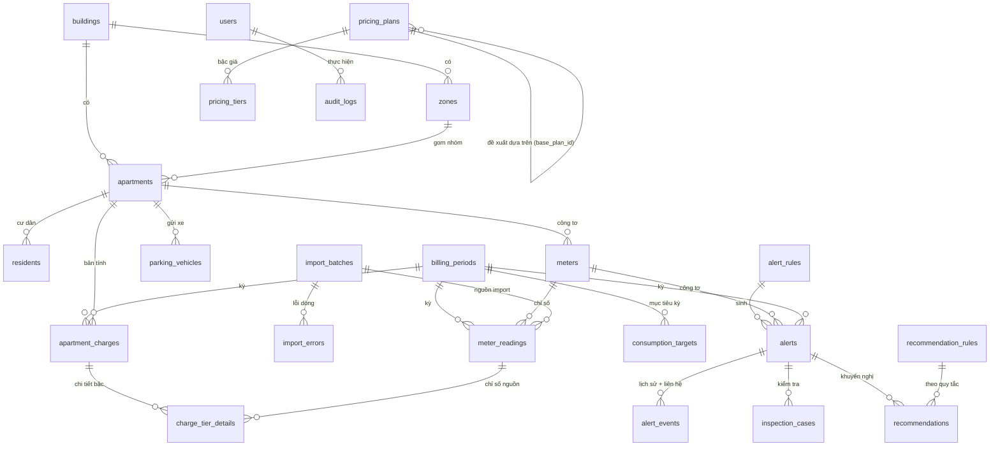

# Cơ sở dữ liệu — Energy & Utility DSS (Topic 09)

> **Schema hiện hành (từ cutover 04/10/2026): v2 — 27 bảng = 26 bảng 3NF + `payment_transactions` (Payment module, mục 7), database `energy_dss_v2`.** DB thật hiện 26 bảng; bảng thanh toán thêm bằng `CREATE TABLE` riêng khi được duyệt.
> **File CSDL duy nhất: `database/energy_dss_v2.sql`** (schema 27 bảng + dữ liệu demo tổng hợp, mục 5). Thiết kế 3NF chi tiết + nhật ký kiểm tra / migrate / refactor: đã lưu trữ (`~/energy-dss-archive/docs-history/docs/DB_3NF_V2_DESIGN.md`).
> DB `energy_dss` (schema cũ v1, 29 bảng) giữ nguyên làm bản **rollback**. Các file lịch sử (schema / seed v1, patch, migrate, backup) đã lưu trữ ngoài bản chạy cuối — mục 6.

MariaDB 10.4 (XAMPP) / MySQL 8.0.16+, InnoDB, `utf8mb4`, collation `utf8mb4_general_ci`.

**Cài mới** (DB rỗng):
```bash
mysql -u root -e "CREATE DATABASE energy_dss_v2 CHARACTER SET utf8mb4 COLLATE utf8mb4_general_ci;"
mysql -u root energy_dss_v2 < database/energy_dss_v2.sql
```
File không có `CREATE DATABASE` / `USE` / `DROP`; nạp vào DB đã có bảng sẽ báo lỗi (không ghi đè). Bộ test dựng mọi DB tạm bằng đúng 2 lệnh này (`tests/support/create_test_db.sh`) và kiểm tra cài mới ở `tests/run_install_upgrade_test.sh`.
Tài liệu này là bản tóm tắt; chi tiết từng cột nằm trong `COMMENT` của schema (`database/energy_dss_v2.sql`).

## 0. Schema v2 (hiện hành) — khác v1 ở đâu

v2 = v1 bỏ / gộp 6 bảng thành 3 bảng; **23 bảng còn lại giữ nguyên** (cùng cột, cùng id).

| v1 (29 bảng) | v2 (26 bảng) | Ghi chú |
|---|---|---|
| `tariffs`, `tariff_tiers`, `tariff_proposals`, `fixed_fee_rates` | `pricing_plans` (`price_type` = `utility` / `fixed_fee`; `origin` = `direct` / `proposal`; `approval_status`; `status`), `pricing_tiers` | Biểu giá, phí cố định và đề xuất cùng một bảng. Bậc của đề xuất nằm ở `pricing_tiers` (không còn JSON `proposed_data`). Duyệt đề xuất = **chính dòng đề xuất** thành phiên bản hiệu lực. Id biểu giá giữ nguyên; phí cố định được đánh số lại (1–7 → 45–51, xem `id_map.csv` của lần cutover) |
| `alert_status_history`, `alert_contact_logs` | `alert_events` (`event_type` = `state_change` / `contact`) | Dòng thời gian cảnh báo một bảng, theo thứ tự thời gian |
| `recommendation_rules.condition_params` (JSON) | `recommendation_rules.n_periods`, `utility_type` | Cột thường thay JSON (`chk_recrule_n_periods`) |

- Ứng dụng đọc / ghi v2 qua Repository (`App\Core\Schema::isV2()` — có bảng `pricing_plans`); Repository trả về dòng **cùng dạng v1** nên Service / Controller / View không đổi. Cùng mã nguồn chạy được trên cả `energy_dss` (rollback) và `energy_dss_v2`.
- Ràng buộc mới: `chk_pricing_subtype`, `chk_pricing_flat_price`, `chk_pricing_values`, `chk_pricing_lifecycle`, `chk_pricing_origin`, `chk_pricing_rejection` (pricing_plans), `uq_tier_order` + `chk_tier_range` (pricing_tiers), `chk_event_shape` (alert_events). Toàn schema v2: **57 khoá ngoại, 14 CHECK có tên**.
- Mục 1 – 3 bên dưới mô tả theo module; với nhóm biểu giá / lịch sử cảnh báo, tên bảng v1 được ghi kèm bảng v2 tương ứng.

## 1. Bảng theo module

| Module | Bảng | Vai trò |
|---|---|---|
| FN-01 Tài khoản, phân quyền, audit | `users` | Tài khoản, vai trò (`bql`, `ky_thuat`, `ke_toan` — đúng 3 vai trò, FR-01), trạng thái (`hoat_dong`, `ngung`, `khoa_tam`), đếm đăng nhập sai |
| | `audit_logs` | Nhật ký ai / khi nào / đối tượng / giá trị cũ → mới (JSON). Ứng dụng chỉ INSERT và đọc (BR-04) |
| | `system_configs` | Tham số hệ thống (5 khoá whitelist — FN-01.07) |
| FN-02 Danh mục | `buildings`, `zones`, `apartments`, `residents`, `meters`, `parking_vehicles` | Tòa nhà → khu vực → căn hộ → cư dân / công tơ / phương tiện gửi xe |
| FN-03 Biểu giá & phí | v2: `pricing_plans`, `pricing_tiers` (v1: `tariffs`, `tariff_tiers`, `tariff_proposals`, `fixed_fee_rates`) | Phiên bản biểu giá theo ngày hiệu lực, bậc giá, đề xuất / duyệt, phí cố định & gửi xe |
| FN-04 Chỉ số | `billing_periods`, `meter_readings`, `import_batches`, `import_errors` | Kỳ, chỉ số theo công tơ × kỳ, lô import Excel + lỗi theo dòng |
| FN-05 Tính phí | `apartment_charges`, `charge_tier_details` | Bản tính phí theo căn × kỳ, chi tiết từng bậc giá (gắn chỉ số nguồn) |
| FN-06 Phân tích | `baselines`, `consumption_targets` | Mức nền (Baseline) theo phạm vi, mục tiêu tiêu thụ theo kỳ |
| FN-07 Cảnh báo | `alert_rules`, `alerts`, v2: `alert_events` (v1: `alert_status_history`, `alert_contact_logs`), `inspection_cases` | Quy tắc ngưỡng, cảnh báo, lịch sử trạng thái + nhật ký liên hệ, yêu cầu / kết quả kiểm tra |
| FN-08 Khuyến nghị | `recommendation_rules`, `recommendations` | Quy tắc khuyến nghị, khuyến nghị gắn cảnh báo |
| FN-09 Dashboard / báo cáo | — | Chỉ đọc từ các bảng trên (không có bảng riêng) |
| FN-10.03 Email (Secondary) | `email_notifications` | Hộp thư đi / lịch sử gửi thông báo phí qua email (patch 004) |

## 2. Quan hệ chính



- `baselines` và `consumption_targets` dùng phạm vi đa hình `scope_type` + `scope_id` (baseline: `meter`, `apartment`, `zone`, `building`; mục tiêu: `apartment`, `zone`, `building`), không có FK tới bảng phạm vi.
- Mọi cột `created_by` / `confirmed_by` / `locked_by`… tham chiếu `users` (`ON DELETE SET NULL` cho `audit_logs.user_id`).
- v2: 57 khoá ngoại ở 26 bảng 3NF (+2 của `payment_transactions` = 59; v1: 53 khi viết bản này, trước patch 005).

## 3. Ràng buộc toàn vẹn quan trọng

| Ràng buộc | Bảng | Ý nghĩa |
|---|---|---|
| `uq_reading_meter_period` (meter_id, billing_period_id) | `meter_readings` | Mỗi công tơ chỉ 1 chỉ số / kỳ (VAL-04.03) |
| `uq_charge_apartment_period` (apartment_id, billing_period_id) | `apartment_charges` | Mỗi căn 1 bản tính / kỳ |
| `uq_alert_dedupe` (alert_rule_id, apartment_id, dedupe_meter_id, billing_period_id) | `alerts` | Đánh giá lại không sinh cảnh báo trùng (cột sinh `dedupe_meter_id` thay cho `meter_id` nullable) |
| `uq_rec_alert_rule` (alert_id, recommendation_rule_id) | `recommendations` | Không trùng khuyến nghị (patch 002) |
| `uq_target_scope_period` | `consumption_targets` | Một mục tiêu / phạm vi / tiện ích / kỳ |
| `uq_tier_order`, `chk_tier_range` (`tier_from >= 0`, `tier_to > tier_from`) | `pricing_tiers` (v1: `tariff_tiers`) | Bậc giá hợp lệ, nửa khoảng `[from, to)` |
| `uq_period_code`, `uq_meters_code`, `uq_users_username`, `uq_buildings_code`, `uq_zones_building_code`, `uq_apartments_building_code`, `uq_vehicle_apartment_type`, `uq_system_configs_key` | danh mục | Mã duy nhất |
| `CHECK (json_valid(...))` | `audit_logs`, `import_batches`, `alert_rules`… (v1 thêm `tariff_proposals`) | Cột JSON hợp lệ |
| Mọi cột tiền / đơn giá / chỉ số: `DECIMAL` | — | Không dùng FLOAT/DOUBLE; tính tiền bằng bcmath theo xu (`MoneyCalculator`) |

Ràng buộc nghiệp vụ không thể hiện được bằng DDL (kỳ đã khoá không sửa, máy trạng thái cảnh báo, ≥ 1 BQL hoạt động…) được kiểm ở tầng Service trong transaction có khoá dòng; xem [`ARCHITECTURE_SUMMARY.md`](ARCHITECTURE_SUMMARY.md) mục 2.

## 4. Lịch sử patch (schema v1 — đã lưu trữ)

Các patch dưới đây đã được áp vào schema v1 trước khi chuyển sang v2; nội dung của chúng đã nằm trong schema 26 bảng. File patch đã lưu trữ (mục 6), bản chạy cuối không cần.

| Patch | Nội dung | Áp dụng |
|---|---|---|
| `001_schema_review_fixes.sql` | Bậc giá nửa khoảng `[from, to)`; `scope_id NOT NULL` cho UNIQUE baseline / mục tiêu; khoá chống trùng cảnh báo; `charge_tier_details.meter_reading_id`; `meter_readings.import_batch_id`; `import_batches.control_total_details` (JSON); sửa comment | Chỉ cho DB tạo từ schema cũ |
| `002_recommendation_dedupe.sql` | UNIQUE `uq_rec_alert_rule` (D-1) | Sau 001 |
| `004_email_notification.sql` | `residents.email VARCHAR(255) NULL`; bảng `email_notifications` (hộp thư đi: người nhận, tiêu đề, nội dung lưu, `content_hash`, `status` pending / sent / failed, `attempt_count`, `last_error`, `transport`, `sent_at`); UNIQUE `uq_email_dedupe` (bản tính, email, loại, content_hash). Preflight: cần patch 003, chỉ chạy 1 lần; tạo bảng trước rồi mới thêm cột (lỗi giữa chừng không để lại trạng thái dở dang) | Sau 003 |
| `003_remove_admin_role.sql` | `users.role` = ENUM(`bql`, `ky_thuat`, `ke_toan`) — bỏ `admin` (J-01 đã chốt: 3 vai trò). Preflight dừng nếu còn tài khoản role `admin` | Sau 002 |
| `005_j16_consumption_verification.sql` | [BA Proposal J-16] bảng `alert_contact_logs` (v2: gộp vào `alert_events`); `alerts.alert_type` (`threshold` / `no_usage_consumption`), `source` thêm `he_thong`. Chỉ thêm / nới, không đổi dữ liệu sẵn có | Sau 004 |

- STEP 15 – 16: không đổi schema. Đợt chuẩn hoá vai trò (sau STEP 16): chỉ đổi ENUM `users.role` (patch 003).

## 5. Dữ liệu demo (trong `database/energy_dss_v2.sql`)

Dữ liệu **tổng hợp** (tên giả, email trống), không lấy từ DB thật. Là đúng dữ liệu seed cũ (`seed_data.sql` của v1) sau khi migrate sang v2: DB nạp từ `energy_dss_v2.sql` trùng DDL 26 bảng, trùng CHECKSUM dữ liệu và AUTO_INCREMENT với DB dựng theo cách cũ (v1 + seed → migrate) — đã kiểm 04/10/2026. 89 dòng dữ liệu.

| Nhóm | Nội dung |
|---|---|
| Tài khoản | `bql01`, `kythuat01`, `ketoan01` — mật khẩu `Password@123` (**chỉ demo**) |
| Danh mục | 1 tòa nhà (Chung cư A), 3 khu, 4 căn (BT1 biệt thự 80 m², S01 shophouse kinh doanh, CC-2305, CC-2306 không phát sinh), 4 cư dân (tên giả), 8 công tơ (1 điện + 1 nước / căn), xe: BT1 1 ô tô, S01 2 xe máy |
| Biểu giá & phí | `pricing_plans` 11 dòng: 4 biểu giá (điện / nước × sinh hoạt / kinh doanh) hiệu lực 01/01/2024 + 7 loại phí cố định & gửi xe; `pricing_tiers` 10 bậc (điện sinh hoạt 6 bậc 1.806 → 3.151 đ/kWh, VAT 8%) |
| Kỳ | **06/2024 Đã khóa** (8 chỉ số đã xác nhận, 4 bản tính đã phát hành — dữ liệu lịch sử để so sánh); **07/2024 Mở**, chưa có chỉ số (dùng để demo) |
| Phân tích | Baseline BT1 điện (cấp căn hộ, "kỳ trước") = 343 kWh; mục tiêu BT1 điện 07/2024 = 320 kWh |
| Quy tắc | 2 quy tắc cảnh báo "điện / nước vượt baseline > 30%" (giá trị UAT, J-32); 2 quy tắc khuyến nghị ("CL = 0 trong 2 kỳ", "vượt ngưỡng 1 kỳ") |
| Tham số | 9 tham số hệ thống: phiên / khoá đăng nhập (3), tài khoản thu tiền, chế độ import, 4 ngưỡng ưu tiên J-16 |
| J-16 | Căn **CC-2306** khai báo "Không phát sinh điện nước" — khi có chỉ số CL > 0 được duyệt, hệ thống tự sinh cảnh báo J-16 |

Không có sẵn chỉ số, bản tính, cảnh báo, khuyến nghị hay email của kỳ 07/2024: mọi kết quả này được tạo trong lúc demo ([`DEMO_FINAL.md`](DEMO_FINAL.md)) — cùng trạng thái mà bộ test kiểm tra.

## 6. Lịch sử CSDL (đã lưu trữ, không thuộc bản chạy cuối)

Chuyển ra `~/energy-dss-archive/database-history/` ngày 04/10/2026 (giữ nguyên đường dẫn tương đối, SHA-256 không đổi, không xoá):

| Đường dẫn cũ | Nội dung |
|---|---|
| `database/energy_dss.sql`, `database/seed_data.sql` | Schema v1 (29 bảng, đã gồm patch 001 → 005) + seed v1 — nguồn sinh dữ liệu demo của `energy_dss_v2.sql` |
| `database/energy_dss_v2_target.sql` | Schema đích 26 bảng (STEP 3B) — phần schema của `energy_dss_v2.sql` lấy nguyên văn từ file này |
| `database/patches/` | Patch 001 → 005 cho DB v1 cũ |
| `database/migrations/v2/` | Script migrate v1 → v2 (`migrate_energy_dss_to_v2.php`, `run_migration.sh`) + kết quả đối soát lần cutover (`output/20261004_101518/`, gồm `id_map.csv`) |
| `database/backups/energy_dss_pre_cutover_20261004_101510.sql` | Backup DB `energy_dss` ngay trước cutover (**dữ liệu thật**) |
| `database/backups/energy_dss_before_schema_patch.sql` | Fixture test nâng cấp (schema v1 trước patch 001). **Reconstructed pre-patch-001 test fixture; matches all known structural evidence, but original checksum was unavailable.** Bản gốc bị xoá nhầm 04/10/2026; dựng lại từ bản `energy_dss.sql` trong lịch sử file của Claude Code, khớp 27 bảng / 0 dòng / 45.302 byte / 1.000 dòng / vị trí `CREATE TABLE`; SHA-256 `356693d7…581940` |
| `database/tests/schema_review_test.php` | Đã chuyển vào `tests/schema_review_test.php` (bản trong thư mục lưu trữ là bản gốc) |

Đi cùng việc lưu trữ: bộ test chỉ còn chế độ v2 (dựng DB tạm từ `energy_dss_v2.sql`); các test nâng cấp schema v1 cũ (patch 001 → 005) và migrate v1 → v2 không còn chạy. Cần lại (vd rollback rồi migrate lần nữa): lấy file từ thư mục lưu trữ.

## 7. Thanh toán — `payment_transactions` (Payment module)

Bảng thứ 27, chỉ thêm (không sửa bảng cũ, không thêm cột vào `apartment_charges`). Có trong `database/energy_dss_v2.sql`; DB thật `energy_dss_v2` thêm bằng `CREATE TABLE` riêng khi được duyệt — trước đó chức năng thanh toán tự ẩn (kiểm tra bảng tồn tại), DB rollback `energy_dss` (v1) cũng vậy.

| Cột | Ý nghĩa |
|---|---|
| `transaction_id` UNIQUE | Mã giao dịch phía ngân hàng — idempotency |
| `source` | `mock_bank` (chỉ ngân hàng giả lập) |
| `amount`, `transfer_content`, `payer_name`, `received_at` | Số tiền (CHECK > 0), nội dung chuyển khoản (chứa mã thanh toán `EDSS` + id bản tính), người chuyển, thời điểm |
| `apartment_charge_id` | Bản tính khớp (FK, `ON DELETE RESTRICT`); NULL khi không rõ mã |
| `match_status` | `matched` / `manual_matched` (đã ghi nhận) · `amount_mismatch` / `unknown_ref` / `not_payable` / `already_paid` (cần kiểm tra) · `ignored` (đã xử lý ngoài hệ thống) |
| `match_note`, `reviewed_by`, `reviewed_at`, `review_note` | Lý do đối soát tự động; người / lúc / lý do khi Kế toán khớp thủ công hoặc bỏ qua (CHECK bắt buộc) |
| `raw_payload` | Payload callback đã xác thực HMAC (CHECK JSON hợp lệ) |

- **Trạng thái thanh toán không lưu** (3NF): tính từ giao dịch — Đã thanh toán / Cần kiểm tra / Chưa thanh toán (`PaymentStatusService`). Mã thanh toán suy ra từ id bản tính, không lưu cột.
- Ràng buộc: `uq_payment_transaction`, `chk_payment_amount`, `chk_payment_payload`, `chk_payment_matched_charge` (đã khớp / cần kiểm tra theo bản tính phải có bản tính), `chk_payment_review` (khớp thủ công / bỏ qua phải có người + lý do).
- Email xác nhận thanh toán dùng `email_notifications` với `notification_type = 'payment_confirmation'` (không đổi schema).
